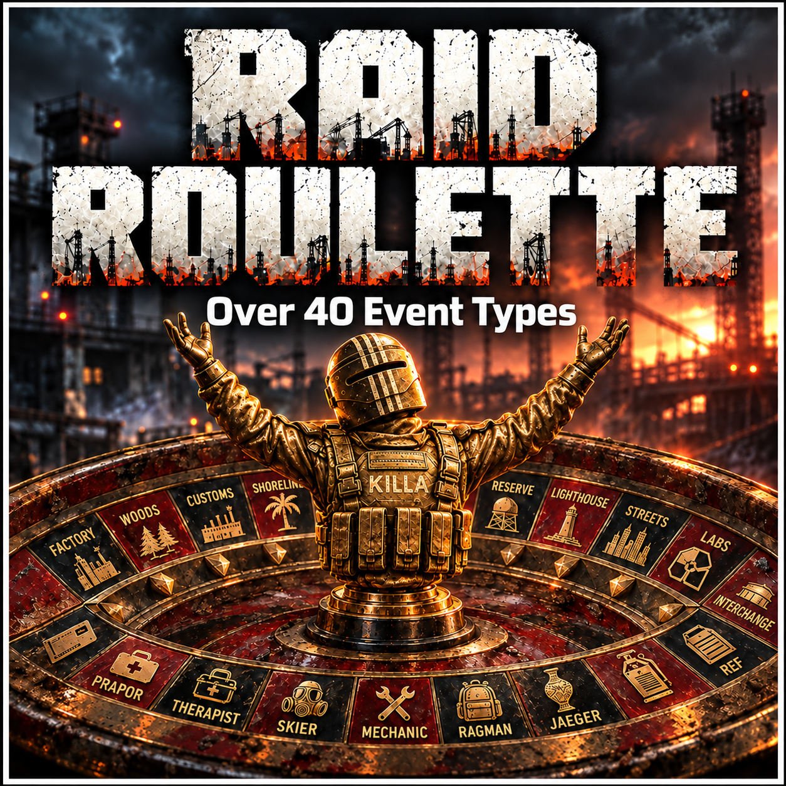

# Raid Roulette



**Created by killdg, with assistance from ChatGPT.**

Keep your usual raids—or let something unexpected take over. Raid Roulette adds themed opposition, unusual loot, weather, hallucinations and wave challenges to **SPT 4.1.6**.

> **Public beta:** client **2.0.146**, server **2.0.0-preview.68**, for **SPT 4.1.6**. Some events have player-confirmed tests; others still need final checks. Please report problems through [Issues](https://github.com/killdg/Raid-Roulette/issues). See [testing status](docs/VALIDATION.md).

**[Download the full beta package](https://github.com/killdg/Raid-Roulette/releases/download/v2.0.146-beta/Raid-Roulette-2.0.146.zip)** · [Release notes and matching source](https://github.com/killdg/Raid-Roulette/releases/tag/v2.0.146-beta)

## About this project

Raid Roulette is an experiment in how far we can push SPT and its engine to create unusual, varied raids. These events also explore ideas and engine interactions for future **quest packs** I intend to build.

Please report anything that does not work as expected through the **Issues** tab. Include the event, map, installed versions, what happened and any other mods you use; share only relevant, redacted log excerpts.

I will investigate reported conflicts with other mods where I can, but **compatibility with every mod cannot be promised**. **SAIN and Fika** are specific compatibility goals I intend to spend time on. Full compatibility is the aim, not a claim that it has already been achieved. The current main edition remains a solo build.

## Two ways to play

### Let events happen naturally

Press **F1**, expand **Raid Roulette**, and keep **Enable Raid Roulette** on. With **Trader Event Activation off**, choose a raid preset:

| Preset | Normal raids | Event raids |
| --- | --- | --- |
| Mostly Normal (default) | 90% | 10% |
| Half And Half | 50% | 50% |
| Custom | Your chosen normal share | Your enabled event weights |

Custom separates **how often anything unusual happens** from **which events you enjoy**. Set the normal-raid chance, enable the event types you want, and give those events relative weights. Equal weights make enabled events equally likely; a larger weight makes an event more frequent within the event share. Set an event's weight to zero or disable it to leave it out. You do **not** need to make dozens of values add up to 100.

For example, Normal 60% leaves 40% for events. Giving Stormtide a weight of 3 and Clone Wars a weight of 1 makes their overall shares 30% and 10%. If Stormtide is unsupported on your selected map, its share becomes Normal: on Labs that example becomes 90% Normal and 10% Clone Wars. Unsupported shares are not redistributed to force another event.

Changes apply to the next generated raid. Existing saved preferences are preserved when updating.

### Choose the next raid through Fence

Enable **Trader Event Activation** in F1, then visit **Fence → Tasks**. Accept an **[RR: Event Name]** assignment to choose that event for your next eligible **PMC** raid. Accepting another RR assignment replaces the previous selection; events do not stack.

The deployment map shows a gold **[RR]** badge beside locations that support **your accepted assignment**. Hover over it for the event name. No accepted RR task means no all-events marker clutter. Stormtide excludes Labs and Factory; Lab Work Day is Labs-only. All four season choices exclude Labs and include Factory, although some seasonal differences there are subtle.

An unsupported map runs Normal and leaves the selection waiting. Fence activation owns the selection while enabled; switch it off to return to weighted random raids. Ordinary assignments finish after their event raid regardless of survival. Trials require the relevant wave clear. After an attempt, assignments return as fresh, unaccepted offers; startup also clears stale RR selections left by an interrupted session. These are reusable, reward-free event selectors, separate from the story quest pack.

**Gun Game [Respawns]** is a separate Fence choice. Defeat resets the ladder and knife bonus; respawning restores health and starts again with a pistol. The raid countdown continues.

## What can happen?

- **Opposition:** a pursuing boss, a boss gathering, Raiders, Cultists, guards, clones or themed Scav/PMC groups.
- **Equipment:** pistols, shotguns, sniper rifles, high-capacity magazines, powerful gear, smoke or explosive grenades.
- **World changes:** Stormtide, Blue Day mortar barrages, Infrastructure Decay, four seasons, Time Warp and Wrong Door.
- **Challenges:** Gun Game, respawning Gun Game, ten-wave Trials, Guard Trials, Extreme Trials, Snowball Trials and Total Trial.
- **Stranger encounters:** The Thief, Lab Work Day and Schizophrenia.

Read the [short event guide](docs/Event-Overview.md) or [expand individual event details](docs/Event-Guide.md) before choosing—or discover the surprises yourself. A few **easter eggs** reward curiosity. Their solutions are deliberately left out of the player guide.


## Installation

Close the game and SPT server. Extract the beta installer ZIP into the **SPT installation root**, merging:

```text
README.md
BepInEx/
SPT_Runtime/
```

Use matching client/server files from the same package. Do not install source archives as mods. Existing settings and profiles are not part of the installer and must not be replaced.

**F1** opens SPT's Configuration Manager when that menu provider is installed and its shortcut is unchanged. The menu provider is not created or bundled by Raid Roulette. Configuration is also saved in `BepInEx/config/com.killdg.raidroulette.testing.cfg`.

The optional **DG Testing Tools** package exposes developer diagnostics. Ordinary players do not need it. The separate **Raid Roulette Tasks** package contains story missions and requires the RR engine; it is not included here.

## Compatibility and limits

- Designed and tested against **SPT 4.1.6**, using the game's and SPT's assemblies.
- The main edition targets **solo play**. A separate Fika Edition is being investigated; no co-op support is claimed for this build.
- No additional AI, loot, weather or gameplay mod is required. Other mods that alter the same systems may conflict; combinations have not all been tested.
- AI still depends on native navigation and physics. Recovery relocations in Trials must be concealed at both ends; they are not a new navigation mesh.
- Blackouts affect supported runtime sources. Baked lighting and some displays may remain visible.
- Compilation and automated checks do not prove live movement, audio, extraction or quest lifecycle behavior.

## Source, builds and transparency

[Build instructions](docs/BUILDING.md) · [Engine overview](docs/ARCHITECTURE.md) · [Data scope](docs/DATA-SCOPE.md) · [Testing status](docs/VALIDATION.md)

Source uses conventional readable C#, with comments around unusual engine integration. No obfuscation or minification is used. Game/SPT binaries, decompiled game source, profiles and credentials must not be uploaded. Download releases are built from the exact tagged source and carry checksums and build provenance. This release is a beta, not a guarantee that every event or mod combination is fully verified.

## Credits

**Raid Roulette is created by killdg, with assistance from ChatGPT.**

**Inspiration:** [Dynamic Raid Events](https://sp-mod.com/mod/2842/dynamic-raid-events) by **[Cobra](https://github.com/CobraSnipper)** inspired this project. Any reused third-party code retains its applicable copyright and license notices.

Original project source is licensed under [MIT](LICENSE). SPT, Unity, BepInEx, Harmony and game assets retain their respective ownership and licenses.

If you enjoy the mod, [you can feed my caffeine addiction](https://ko-fi.com/killdg).
